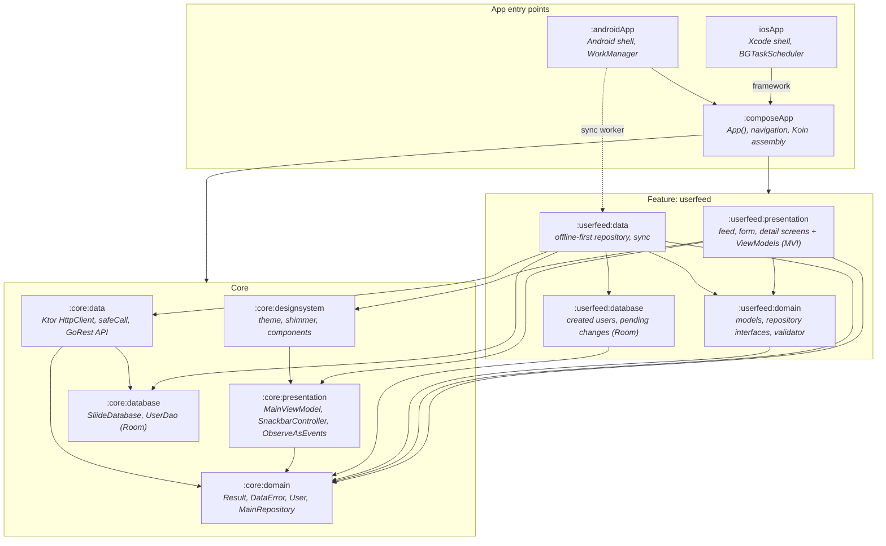
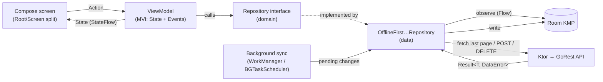
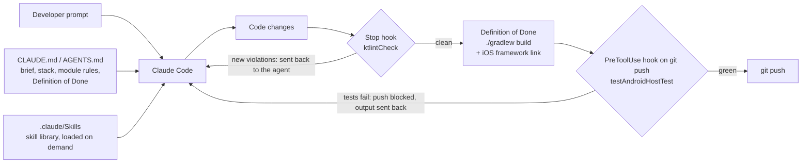

# Sliide User Management (KMP)

A Kotlin Multiplatform user-management app for Android and iOS, built on the [GoRest](https://gorest.co.in) API.
The UI is 100% shared Compose Multiplatform (Material 3, dark mode, adaptive layouts). The architecture is Clean
Architecture + MVI, with Ktor for networking, Room KMP as an offline-first cache and Koin for DI.

- [Architecture at a glance](#architecture-at-a-glance)
- [AI setup](#ai-setup): how the app was built with Claude Code, the skills it used, and the quality gates on the agent
- [Architecture notes](#architecture-notes): design decisions per area
- [Assumptions & trade-offs](#assumptions--trade-offs)
- [Running the apps](#running-the-apps) · [Running tests and checks](#running-tests-and-checks)

## Architecture at a glance

### Modules

Every module is built by a convention plugin from `build-logic` (`kmp.library`, `cmp.library`, `cmp.feature`, `room`,
`buildkonfig`, `ktlint`), so module build files only declare their dependencies. Arrows mean "depends on".

**Dependency rules** (enforced by how the modules are wired):

- Presentation depends on **domain** only, never on a data module. ViewModels see repository *interfaces*.
- Data modules implement the interfaces declared in domain. Only the app modules see both sides, to bind them in Koin.
- Features never depend on other features. Shared code goes into `:core:*`.

### Runtime data flow

Room is the single source of truth. The UI only ever observes the database; the network writes into it.

## AI setup

The app was built with **Claude Code** as the coding agent, steered by three things committed to this repo: a project
brief, a skill library, and hooks that gate the agent's output.

| Piece | Where | What it does |
|---|---|---|
| Project brief | [`CLAUDE.md`](CLAUDE.md) (symlink to [`AGENTS.md`](AGENTS.md), so other agents read the same file) | The challenge requirements, the fixed stack, the multi-module target and dependency rules, the Definition of Done (`./gradlew build` + iOS link must pass, never weaken tests to get green), and an index of the skills with when to use each one. |
| Skill library | [`.claude/Skills`](.claude/Skills) (git submodule of [PL-Coding-GmbH/Skills](https://github.com/PL-Coding-GmbH/Skills), MIT) | ~30 skills on KMP module structure, the data layer, error handling, MVI presentation, Koin, navigation, coroutines/flows, Compose, adaptive layouts and testing. The brief tells the agent to load a skill **only** when the task matches it, and to prefer the KMP-specific skill when two overlap. The notes below name the skill behind a decision where it applies (e.g. `android-di-koin`, `kotlin-coroutines`). |
| Quality gates | [`.claude/settings.json`](.claude/settings.json), [`.claude/hooks/`](.claude/hooks) | Two hooks, described below, that run whether or not the agent remembers to check its own work. |
| Memory | Claude Code's per-project memory (local, not in the repo) | Kept the clarifications agreed during the build (e.g. "last page" means the literal last page, created users stay local-only, the Room schema stays at v1), so later sessions didn't re-ask or drift. |

**Agents.** All of the work was done by the main Claude Code agent; no custom subagents were used. The skills
submodule also ships reviewer agent definitions (`.claude/Skills/agents/`), but they are not registered in this
project.

### Quality gates on the agent

A prompt can *ask* an agent to lint and test; a hook makes it happen every time. Both hooks are plain shell scripts.

- **Lint after every turn: `Stop` → [`stop-lint.sh`](.claude/hooks/stop-lint.sh).** When the agent finishes a turn
  with Kotlin changes in the working tree, the hook runs `./gradlew ktlintCheck`. New violations are returned to the
  agent as a `block` decision with the file, line and rule, so it has to fix them (usually with `./gradlew ktlintFormat`)
  before it can hand back. The hook checks `stop_hook_active`, so a violation the agent can't fix ends the turn instead
  of looping.
- **Unit tests before every push: `PreToolUse(Bash)` → [`pre-push-tests.sh`](.claude/hooks/pre-push-tests.sh).** Any
  command containing `git push` (including `git -C dir push` and `git commit … && git push`) first runs
  `./gradlew testAndroidHostTest` across all modules. If a test fails, the hook exits with code 2: the push never runs
  and the failing test names go back to the agent. `onFailure: block` means a crash or timeout in the hook blocks the
  push too, rather than letting it through.
- **ktlint is part of the build, not only the hook.** A `ktlint` convention plugin applies
  [ktlint-gradle](https://github.com/JLLeitschuh/ktlint-gradle) to every module (rules in [`.editorconfig`](.editorconfig),
  Android Studio style, Composable-aware function naming). `ktlintCheck` is part of `check`, so `./gradlew build` fails
  on new violations too. Violations from before the linter existed are recorded in each module's `ktlint-baseline.xml`
  rather than fixed in one mass reformat.

Both gates were checked against deliberate failures: a planted failing test blocked a synthetic `git push` with the
test name in the message, and a badly formatted `commonMain` file produced a `block` listing each violation.

## Architecture notes

### Typed results & safe networking

- **`Result<D, E : Error>`** (`:core:domain`, `core.domain.util`) is the single success/failure type used across layers, with
  `map`, `onSuccess`, `onFailure` and `asEmptyResult` helpers. Expected failures never surface as exceptions.
- **`DataError`** splits into `Network` and `Local`. `Network.UNPROCESSABLE_ENTITY` was added for GoRest's **422**
  validation responses (e.g. "email has already been taken") so the Add User form can react specifically.
- **`HttpClient.get / post / delete`** (`:core:data`, `HttpClientExt.kt`) wrap Ktor calls in `safeCall`, which maps
  HTTP statuses and exceptions (timeouts, serialization, connectivity) to `Result<T, DataError.Network>`.
  Data sources stay one-liners: `httpClient.get<List<UserDto>>("users", mapOf("page" to page))`.
- **Only `expect`/`actual`:** `Throwable.toPlatformNetworkError()`. Connectivity failures are genuinely engine-specific:
  OkHttp throws `UnknownHostException`/`ConnectException`, while Darwin throws `DarwinHttpRequestException` carrying an
  `NSURLError` code. Everything else in the networking stack is common code.

### Loading users (launch screen → feed)

- **Flow:** `App()` → `MainViewModel` → `MainRepository` → `MainApi` → Ktor `HttpClient`. There is no splash
  *route*: `App()` shows `SplashContent` while `MainViewModel.isLoading`, then crossfades to `NavigationRoot` (feed).
- **Android** keeps the system splash (`core-splashscreen`) up via `setKeepOnScreenCondition { isLoading }`;
  `MainActivity` passes its `MainViewModel` into `App()` so both observe the same state.
- **iOS** launch screens are static and can't be held, so `UILaunchScreen` (`LaunchBackground` + `LaunchLogo`, 160pt)
  is followed by `SplashContent`, which draws the same colour and logo at the same size — users see one continuous
  splash.
- **Contracts:** `User` and `MainRepository` live in `:core:domain`; `UserDto` (`@Serializable`), the `toDomain()`
  mapper, `MainApi`, `KtorMainApi` and `OfflineFirstMainRepository` live in `:core:data`, so serialization types never leak
  into domain or presentation.
- **Last page:** `KtorMainApi.getLastPageUsers()` requests the page it believes is last (page 1 on a cold start) and
  checks that response's `x-pagination-pages` header; if the count differs it follows it (all with `per_page=20`).
  `HttpClient.get` returns the body together with the response headers (`NetworkResponse`), through the same
  `safeCall` status/exception mapping. See *Assumptions & trade-offs* for why it works this way.
- **Offline-first:** Room is the single source of truth. `OfflineFirstMainRepository.loadUsers()` fetches the last
  page and swaps it into the table with `UserDao.replaceAll()` (one transaction), so the table always holds exactly that
  page and needs no local pagination. `observeUsers()` only ever reads the database. A failed fetch leaves the cache
  untouched.
- **Startup:** `MainViewModel` only calls the network when the database is empty. With cached users it skips the
  fetch entirely and opens the feed; if the fetch fails, the feed opens on its empty state. `MainViewModel` exposes
  a single `isLoading: StateFlow<Boolean>` (no state class), set to `false` once startup is done.
- **Feed:** `UserFeedViewModel` observes `UserFeedRepository.observeUsers()` and shows the list (name, email and sync
  status), or an empty-data state when there are no users.
- **Pull to refresh + shimmer:** pulling the feed down calls `UserFeedRepository.refreshUsers()`, which first sends
  queued changes (`syncPendingChanges()`, failures stay queued) and then `MainRepository.loadUsers()` for the last
  page. Users created on this device live in `created_users`, which the refresh never touches, so they stay at the top.
  During the first database read the list is replaced by shimmering placeholder rows (20 of them, one GoRest page;
  `Modifier.shimmer()` / `ShimmerBlock` in `:core:designsystem`, themed for dark mode). A refresh keeps the cached
  users on screen under the Material spinner (`PullToRefreshBox(isRefreshing = state.isRefreshing)`), so the fetched
  page animates in row by row (`animateItem()`) instead of the whole list being torn down and rebuilt. The list slides
  down with the finger (`graphicsLayer` translation from `PullToRefreshState.distanceFraction`), holds the gap while
  refreshing and springs back afterwards. A failed refresh keeps the cached users and
  shows a snackbar ("No internet connection. Showing saved users."). The empty state is a one-item `LazyColumn`, so it
  can be pulled too, e.g. after an offline first launch.
- **Relative timestamp = last sync.** Each row reads "Synced 5 minutes ago", or "Not synced" while it has a create or
  edit waiting in the pending-sync queue. `users.lastSyncedAt` is stamped by a refresh and by a successful PATCH;
  `created_users.lastSyncedAt` by the 201 and by a successful PATCH. `FeedUser.lastSyncedAt` is null whenever a change
  is pending. `formatSyncStatus()` (shared, pure) turns it into text against a `Clock`, and the ViewModel re-reads the
  clock every minute while the feed is observed, so labels keep moving.

### Creating, editing and deleting users (`:userfeed`)

- **Contracts:** `FeedUser`, `FeedUserId` and `UserFeedRepository` live in `:userfeed:domain`. `UserFeedApi` /
  `KtorUserFeedApi` (`POST users`, `PATCH users/{id}`, `DELETE users/{id}`) and `OfflineFirstUserFeedRepository` live in
  `:userfeed:data`, wired by `userFeedDataModule()`. The DAOs stay in `:core:database` (one `SliideDatabase`).
- **`FeedUserId` is sealed (`Created(localId)` / `Remote(id)`).** Local row ids and GoRest ids are separate sequences
  and can collide, and the repository needs to know which table a row lives in. The list flattens it to a string key
  (`created-1`, `remote-1`) because lazy-list keys must be saveable on Android.
- **Queue first, then the network (an outbox).** Every change is written to Room *together with* its pending-sync entry,
  in one transaction (`DatabaseTransactionRunner`, backed by Room's `useWriterConnection` + `immediateTransaction`),
  before any request. So the feed (a `combine` of the created, cached and pending-sync tables) updates immediately, and
  a change can't be lost if the app dies mid-request: it is already queued, and the next sync sends it. The request
  then sends that queued entry, and the entry is removed only on success. On failure it simply stays queued, and the
  error is returned so the UI can say the change hasn't reached the server yet. An earlier version queued a change only
  *after* its request failed, so a process death mid-request left an unsynced create stranded, an edit silently
  overwritten by the next refresh, or a deleted user brought back.
- **Saves outlive the screen.** The repository runs each change in the injected `ApplicationScope` and awaits it, so a
  save the user confirmed finishes even if the form or details screen closes meanwhile. This replaces the
  `withContext(NonCancellable)` the ViewModels used to wrap saves in: the guarantee now lives in one place, and
  `NonCancellable` is kept for cleanup only (the `kotlin-coroutines` skill).
- **Unsynced creates never hit the network again.** Editing one updates its row (the pending create carries the
  edit); deleting one removes the row and its pending create. Once a created user has a `remoteId`, edits and deletes
  go to the server like any other user.
- **Requests go one at a time, so an older edit can never win.** Saves and syncs share one `Mutex`. Each send re-reads
  its queue entry, so it always sends the latest edit and skips anything a sync already sent. Previously an inline
  PATCH could race a sync's PATCH of an older edit, and if the older one landed last it won on GoRest *and* locally.
  Queuing an edit replaces any older one for that user, and deleting a user drops its queued edit in the same
  transaction that queues the delete.

### Add / edit user form (`UserFormScreen`)

- **One screen, two modes.** The feed's extended FAB ("Add user", shrinking to an icon once the list scrolls)
  navigates to `UserFormRoute()`. `UserFormRoute(createdLocalId, remoteId)` maps to `UserFormMode.Create` or
  `UserFormMode.Edit(FeedUserId)`, which reaches `UserFormViewModel` through Koin's `parametersOf`. In edit mode the
  ViewModel prefills from the feed (`observeUsers().first()`), saves with `updateUser`, and closes if the user no longer
  exists. The ViewModel and its tests support editing; the feed doesn't have an entry point for it yet.
- **Validation lives in `:userfeed:domain` (`UserValidator`) as typed `Result`s** (`NameValidationError`,
  `EmailValidationError`), so it is pure, shared, and unit-tested on both JVM and iOS. Input is normalised first
  (trimmed, with name whitespace collapsed), and the normalised value is both what's validated and what's saved.
  - *Name:* 2 to 100 characters. It must start with a letter in any script (`\p{L}`), followed by letters, combining
    marks, spaces, apostrophes (`'` or `’`), hyphens and full stops. "José Núñez", "O'Brien", "Jean-Luc" and "李小龍"
    pass; digits, symbols and emoji don't.
  - *Email:* a practical subset of RFC 5322, with no quoted local parts or IP-literal domains. The local part is
    dot-separated runs of RFC "atext" characters (no leading, trailing or double dots, at most 64 characters). The
    domain has two or more labels of letters, digits and inner hyphens (at most 63 characters each), ending in an
    alphabetic TLD of 2+ letters. The whole address is at most 254 characters.
- **Real-time, but not hostile.** Both fields are re-validated on every keystroke. The submit button is enabled only
  while both are valid, and a check mark appears in each field as soon as it is valid. An error stays hidden until the
  user has typed in a field and left it, so a fresh form doesn't open covered in red. After that the error follows
  every keystroke.
- **The form waits for GoRest, then closes.** The row is in Room before the POST, so when the 201 arrives and the form
  pops, the new user is already at the top of the feed. The feed scrolls to the top when a created user appears, because
  a keyed lazy list would otherwise keep the old first row in view. Any failure other than 422 has already been queued
  for sync, so the form closes the same way and the row reads "Not synced".
- **A save can't be cut in half.** The change and its queue entry are written in one transaction, and the repository
  runs the save in the application scope, so closing the form mid-save neither loses it nor stops it. The close button
  is still disabled while it runs, so the user sees the outcome.
- **The form keeps its fields across process death** by storing name and email in `SavedStateHandle`. A restored
  edit form keeps the user's typing instead of re-prefilling.

### Adaptive layout (phones, tablets, desktop)

- **The feed and a user's details form one list-detail layout.** `SliideAdaptiveListDetailLayout` (in
  `:core:designsystem`, `components/layouts`) takes a list, a detail and a placeholder, and arranges them by
  `DeviceConfiguration` (in `:core:presentation`, built from the Material 3 adaptive window size class):
  - **Phone held upright:** one pane at a time. Tapping a user slides their details in over the list, and back (or the
    back arrow) slides the list back with its scroll position kept.
  - **Phone on its side, tablets (either way round), desktop:** the list on the start side (40% of the width, clamped
    to 280–400 dp) and the details beside it. The first user is shown until another is picked, and stays the
    fallback, so deleting the shown user moves the details to the next first user. Only an empty list leaves the
    detail pane with a placeholder. A phone held upright never opens a user on its own, since that would hide the
    list. The opened row is highlighted, and the details have no back arrow, since there is nothing to go back
    to.
- **One destination, so turning the device keeps your place.** The opened user lives in `UserFeedState.openedUserId`,
  not in a navigation route. Each user's `UserDetailViewModel` is keyed by user inside the feed's back-stack entry, so
  rotating between one and two panes, even mid-edit, shows the same details with the edit intact. Trade-off: every
  user opened in a session keeps its ViewModel, and that ViewModel's watch for the user disappearing, until the feed
  itself closes. With one page of users that cost is small. The previous design used a detail route, which freed the
  ViewModel on back but lost the edit on rotation.
- **`DeviceConfiguration` checks width before height.** A window narrower than 600 dp is a phone held upright, however
  tall. A wider window shorter than 480 dp is a phone on its side. Only then do width and height separate tablets from
  desktops. This way a small phone in landscape or an unfolded foldable is never treated as a desktop. Unit tests pin
  each case.
- **Each pane pads only for its own edges.** Both panes are full `Scaffold`s, so the layout consumes the inner-edge
  insets. That stops a phone's side navigation bar from padding the middle of the screen.
- **Not adaptive on purpose:** the add/edit form keeps one structure everywhere and only caps its width at 560 dp. The
  skill rules keep structural layouts for structural differences.

### Background sync (WorkManager on Android, BGTaskScheduler on iOS)

- **Every 30 minutes, only while online and only while something is pending.** `PendingSyncScheduling` (shared code)
  watches `observeHasPendingSyncs()` (one Room query over the three pending tables) and schedules the sync whenever
  changes start pending. Only a finished sync cancels it, and only once nothing is left, so nothing wakes up for an
  empty queue. The observer never cancels: the queue can empty mid-sync (deleting a created user whose POST is in
  flight), and cancelling then would stop the worker before it queues the follow-up DELETE. A change queued just as
  the cancel goes through reschedules it. A schedule left over from an earlier run with an empty queue runs once and
  cancels itself.
  `WorkManagerUserSyncScheduler` enqueues a unique 30-minute periodic `UserSyncWorker` with a `CONNECTED` network
  constraint and `KEEP`, so an app restart doesn't reset the period. The first run happens as soon as a network is
  available.
- **The sync logic is shared; only scheduling is per platform.** `UserFeedRepository.syncPendingChanges()` and
  `PendingSyncScheduling` live in common code and are unit-tested on both targets. `UserSyncScheduler` is a domain
  interface with a WorkManager implementation (Android) and a `BGTaskScheduler` one (iOS), each wired by a
  platform-specific `userFeedSyncModule`.
- **iOS: background app refresh plus a sync whenever the app becomes active.** `BackgroundTaskUserSyncScheduler`
  books a `BGAppRefreshTaskRequest` for no earlier than 30 minutes ahead. iOS decides when it actually runs (based on
  battery and how often the app is used), never runs it after the user force-quits the app, and simulators don't run
  it at all. So `IosUserSync` also syncs on every `UIApplicationDidBecomeActiveNotification`, which includes launch.
  An iOS request is used up once it launches, so each background run books the next one first, then syncs. The task
  handler must be registered before launch finishes, so Swift's `iOSApp.init()` calls `startIosApp()`, which starts
  Koin (`MainViewController` no longer does). The identifier is listed in `Info.plist`
  (`BGTaskSchedulerPermittedIdentifiers`, `UIBackgroundModes: fetch`).
- **Syncs never overlap.** A foreground and a background sync can run at the same time on iOS, so
  `syncPendingChanges()` holds a `Mutex`, which a save's own request also takes; otherwise two of them could send the
  same queued change. Each step re-reads its entry before sending, since another send may have handled it.
- **Order: creates, then edits, then deletes.** Each item is sent on its own, so one failure doesn't block the rest.
  A user created offline and then edited or deleted while its POST was in flight gets that edit or delete queued
  straight after the 201, and it is sent in the same run.
- **A queued edit is cleared only if it is still the one that was sent** (matched on `updatedAt`), so a newer edit
  made during the PATCH is kept.
- **WorkManager is initialized by Koin** (`workManagerFactory()` in `SliideApplication`, with the default initializer
  removed in the manifest), so the worker gets the repository by constructor injection. The worker returns `failure()`
  rather than `retry()`: failed items stay queued, and WorkManager resets periodic work to its next period after a
  failure (checked in `WorkerWrapper`) instead of marking it failed.

### Local database (`:core:database`)

- Room KMP database `SliideDatabase` (v1, schema exported to `core/database/schemas`) with a single table
  `UsersTable` (`UserEntity`, keyed by the GoRest id) and `UserDao` (`insertAll` with replace-on-conflict,
  transactional `replaceAll`, `getAll()` as a `Flow` ordered newest-first). Entity ↔ domain mappers live in `:core:data`.
- `DatabaseFactory.create(builder)` mirrors `HttpClientFactory.create(...)`: shared code sets the bundled SQLite driver
  and IO dispatcher. Only obtaining the builder is platform-specific (Android needs a `Context` for the file path; iOS
  uses the Documents directory).
- `UserDao` is tested against a real in-memory Room database on the iOS simulator target (no Android `Context` needed).
- `DatabaseTransactionRunner` / `RoomTransactionRunner` run DAO calls from several DAOs as one transaction. A test on
  the real database throws midway and checks that neither write survived, which proves the DAO calls join it.

### Dependency injection

- **One Koin module per layer, assembled only in the app** (the `android-di-koin` skill). Each core module owns its
  bindings: `coreDatabaseModule` (database and DAOs), `coreDataModule` (`HttpClient`, `Clock`, `MainApi`,
  `MainRepository`) and `corePresentationModule` (`MainViewModel`). Features do the same with `userFeedDataModule` and
  `userFeedPresentationModule`. `initKoin` in `:composeApp` only lists them, so adding a DAO or a feature never touches
  the app's wiring.
- **Platform differences stay inside the owning module.** Android's database builder needs the Koin-provided `Context`,
  so `:core:database` includes an `expect`/`actual` `platformDatabaseModule`. The API key is generated by BuildKonfig
  in `:core:data`, next to the `HttpClient` that uses it. The platform-specific `userFeedSyncModule` is added by each
  app entry point (`SliideApplication`, `startIosApp`).
- **One application scope.** `ApplicationScope` (`:core:domain`, a typed `CoroutineScope`, so it needs no qualifier) is
  bound once in `coreDataModule`. The repository and `UserFeedViewModel` use it for work that must outlive a screen, and
  both app entry points start the sync observers in it instead of creating their own scopes.
- **Constructor references by default** (`singleOf`, `viewModelOf`). `Clock.System` is bound once, so classes that take
  a `Clock` can use them too; tests still pass a fake clock directly. The lambda form is kept only where route
  arguments arrive through `parametersOf`.

### Strings and localisation

- **All UI copy lives in the owning presentation module's Compose Multiplatform resources**
  (`userfeed/presentation/src/commonMain/composeResources/values/strings.xml`, generated `Res` in
  `…userfeed.presentation.resources`), so Android and iOS share one translatable file. Counts use `<plurals>`, and full
  phrases ("Synced %1$d minutes ago") are used rather than fragments joined in code, so translators can reorder words.
- **ViewModel state holds data, not text.** `FeedUserUi.syncStatus` is a `SyncStatus`/`TimeAgo` value (e.g.
  `Synced(Minutes(5))`), which a composable turns into words. Unit tests assert the exact value, including the
  rounding and unit-boundary cases, without depending on resource loading.
- **Snackbars that outlive their screen** ("User added" after the form closes) are passed as a `StringResource` to
  `SnackbarController.show`, which loads the string on the controller's own scope. Loading it on the form's scope
  would be cancelled when the form leaves, and the message would never show.

## Assumptions & trade-offs

- **"Last page" means the final page of `/users`.** Confirmed wit- **Usually one request, two on a cold start.** GoRest gives no direct way to the last page. We checked the live API:
  the page count only comes in the `x-pagination-pages` header, the `x-links-*` headers have no "last" link, `sort`/
  `order` are ignored (always newest first), `page=-1`/`page=last` fall back to page 1, `HEAD` returns 404, and the
  GraphQL endpoint and v1 API (which had pagination in the body) are gone. But *every* page response carries the
  count, so we remember the last page in memory and request it directly next time: if its header agrees, that's the
  answer in one request. On a cold start the guess is page 1, so it costs two. We don't persist the hint: a cold start
  pays one extra request, and saving it would add storage for little gain.
- **`per_page=20` on every request.** The page count depends on the page size, so all calls must agree. GoRest
  accepts up to 100 and silently falls back to 10 above that. The trade-off: the last page holds `total % 20` users
  (anywhere from 1 to 20), so the feed can be short. We accept that because it's what "last page" literally means.
- **The dataset can change between requests.** GoRest is shared and constantly written to. If our page is no longer
  last (it grew), or is now past the end (it shrank, returning `[]`), the header reports the new count and we follow
  it. That's capped at three requests per refresh; if the count is still moving we report an error and keep showing
  the cache. A missing or unreadable count is reported as an error rather than guessing a page.
 A missing or unreadable count
  is reported as an error rather than guessing a page.
- **Created users are local only.** Confirmed with Sliide: other devices don't need to see them. A user created
  from the app (201) is stored in Room and shown at the top immediately; GoRest ids increase, and the feed sorts by
  `id DESC`.
- **Created users live in their own permanent table.** GoRest puts new users on page 1, so they never come back in
  the last page we fetch, and a refresh replaces `UsersTable`. `CreatedUsersTable` keeps every user created on this
  device (with a nullable `remoteId` until the POST succeeds) and is never cleared by a refresh or a sync; the feed
  shows it above the fetched page.
- **Pending syncs: one table per operation (create / update / delete).** Modelled on the Tasky project, but split
  because the three have different shapes: a pending create only needs the created row's `localId` (its payload stays
  on that row), a pending update stores the latest edit keyed by server id (upsert, so only the newest edit is sent),
  and a pending delete is just the server id. A row is removed only after its request succeeds. Editing or deleting a
  user that hasn't been POSTed yet changes or removes the created row in place, so nothing is queued for it. Pending
  updates/deletes are exposed as `Flow`s so the feed can overlay them on server rows a refresh would otherwise restore.
- **Creates send placeholder `gender` and `status`.** GoRest rejects a create without them (422), but the brief's form
  only has name and email, so `KtorUserFeedApi` sends `gender = "female"`, `status = "active"`. They are passed
  explicitly rather than as DTO defaults, because the JSON encoder omits properties left at their default value.
- **A failed sync keeps the change queued; only success removes it.** There are two exceptions:
  - A 404 on a queued edit or delete means the user is already gone from GoRest, so the change is dropped.
  - A 422 on a create (GoRest refuses the user, in practice because the email is already taken) can never succeed.
    So the created user is removed and recorded in `RejectedCreationsTable`, whether the 422 comes back on the first
    POST or in a later sync. The UI reads `observeRejectedCreations()` to show a snackbar and then calls
    `dismissRejectedCreation()`. The record is persisted because the rejection can arrive from a background sync
    while the app is closed. When the 422 comes back to the add-user form, the form shows "This email is already
    taken" inline and stays open, so the user can fix it in place. It then dismisses the rejection record it just
    caused, so the feed won't report it a second time. If the form was closed before the 422 arrived, the record
    stays and the feed reports it.
  - A 422 on a queued edit is still retried every 30 minutes until the user edits or deletes that user again. Known
    gap: the row reads "Not synced" all that time with no explanation. Surfacing it like a rejected create would be the
    next step; the change itself is never dropped.
- **A lost 201 is recovered, not reported as a rejection.** POST isn't idempotent. If GoRest creates the user but
  the 201 never arrives (a timeout, or the app dying mid-request), the create stays queued and its resend is refused
  (422) because the email is now taken. Each pending create therefore records `wasSent` just before its POST. A 422
  on a resend looks the email up (`GET users?email=`; GoRest matches partially, so the exact email is picked) and
  adopts that user's id if the **name matches too**. Otherwise someone else holds the email and it is a genuine
  rejection. If the lookup fails, the create stays queued. A 422 on the *first* POST is never looked up, so the form's
  "email already taken" is unchanged. Gaps we accept: if the user edits the email of a create whose 201 was lost, the
  resend succeeds and GoRest ends up with a stray duplicate; if they edit its name, the lookup sees a different name and
  reports a rejection.
- **GoRest wipes data, so created users can outlive their server copy.** Created users are local-only (above), so a
  user GoRest has since deleted stays in the feed. Editing it gets a 404, which drops the queued edit as "already gone",
  but the row keeps the edited text and its old "Synced … ago" time, so it looks synced when it isn't. Deleting it works
  (a 404 counts as deleted).
- **iOS sync timing is best-effort.** iOS can't guarantee a 30-minute cadence, which is why the app also syncs
  whenever it becomes active.
- **Schema stays at version 1 during development.** The app isn't released, so schema changes edit version 1 in
  place and require reinstalling the app instead of carrying migrations.
- **The timestamp is when the row last matched the server, not when the user was created.** GoRest returns no
  timestamps (`id`, `name`, `email`, `gender`, `status` only), so creation time is unknowable for fetched users. Sync
  time is honest offline: unsynced changes read "Not synced" instead of a misleading age. The cost: rows from one
  refresh all share the same time.
- **Startup fetches only when the cache is empty.** This keeps launch instant and offline-friendly, at the cost of
  showing a cached page until the user refreshes.
- **Tapping a user opens their details; long-pressing opens a delete confirmation bottom sheet.** A bottom sheet
  rather than a dialog keeps the destructive choice within thumb reach, and the long press gives haptic feedback. The
  detail screen ("User") shows the saved details and edits them in place: the app bar's edit button turns the details
  into prefilled, validated fields, the title into "Edit User" and the button into Save. Back (or the close button)
  drops an unsaved edit before it leaves the screen, and Save stays disabled until something actually changed, so an
  untouched save never queues a pointless sync. The feed's own Edit mode still opens the full-screen form.
- **Delete from the details returns to the feed for Undo.** The detail screen's Delete button opens the same
  bottom sheet as the long press (it lives in `presentation/composables`, along with the avatar and validated fields,
  so any screen in the feature can use them). Confirming does not delete there: the Undo window belongs to
  `UserFeedViewModel`, so the confirmed id is handed to it (`OnDeleteRequested`). It closes the details and hides the
  row, and the Undo snackbar appears. Undo brings the row back without reopening the details. One Undo path means one set of rules for when a delete is
  actually sent.
- **Undo works by not sending the delete yet, rather than by reversing it.** A delete that has reached GoRest (204)
  can't be undone: re-creating the user would give it a new id, and could even be refused (422). So "restore the local
  state before the action is finalized" is read literally. After you confirm, `UserFeedViewModel` only hides the row,
  which the keyed list animates out, and offers Undo for 5 seconds. When that time runs out it calls `deleteUser`,
  which removes the row from Room and sends the DELETE (queuing it if offline). Undo simply shows the row again, and no
  request is ever made. The timer belongs to the ViewModel, not the snackbar, so the delete still goes through if you
  open another screen meanwhile. Only one Undo is offered at a time, so a second delete sends the first one
  immediately. Trade-offs:
  - The 204 arrives after the undo window, not before the row disappears. The offline-first feed never waited for the
    network to update the UI anyway.
  - Closing the feed during those 5 seconds takes the Undo snackbar with it, so `onCleared()` sends the delete then,
    in the application scope (`viewModelScope` is already cancelled by that point). Previously the timer was cancelled
    with the ViewModel and the delete was silently lost.
  - If the process is killed during those 5 seconds, `onCleared()` never runs and the user is still there next time.
    We accept that: losing a delete is recoverable, whereas a delete that can't be undone is not. Persisting the
    pending delete with an "undo until" time would close this gap.
- **One snackbar host, above the navigation.** `SnackbarControllerHost` (`:core:presentation`) wraps the `NavHost`
  and provides a `SnackbarController` through `LocalSnackbarController`. A message therefore outlives the screen that
  sent it: the form says "User added", "Changes saved" or "This user no longer exists" as it closes. One-off messages
  (`show`) wait their turn. Undo uses `showNow`, which takes down whatever is showing, because its 5-second timer is
  already running and waiting behind a refresh error would leave almost no time to tap it. Because the host isn't the
  feed's own `Scaffold`, the Scaffold can't lift the FAB above the snackbar by itself, so the controller exposes
  the snackbar's `visibleHeight` and the feed pads its FAB by that amount.

## Running the apps

After cloning, fetch the skills submodule: `git submodule update --init`.

- Android app: `./gradlew :androidApp:assembleDebug`, or the run configuration in the IDE.
- iOS app: open [`iosApp`](./iosApp) in Xcode and run it from there.

## Running tests and checks

- Shared unit tests, all modules (the same command the pre-push hook runs): `./gradlew testAndroidHostTest`
- iOS simulator tests (includes the in-memory Room tests): `./gradlew iosSimulatorArm64Test`
- Lint: `./gradlew ktlintCheck`; auto-fix: `./gradlew ktlintFormat`
- Definition of Done: `./gradlew build` and `./gradlew :composeApp:linkDebugFrameworkIosSimulatorArm64`
